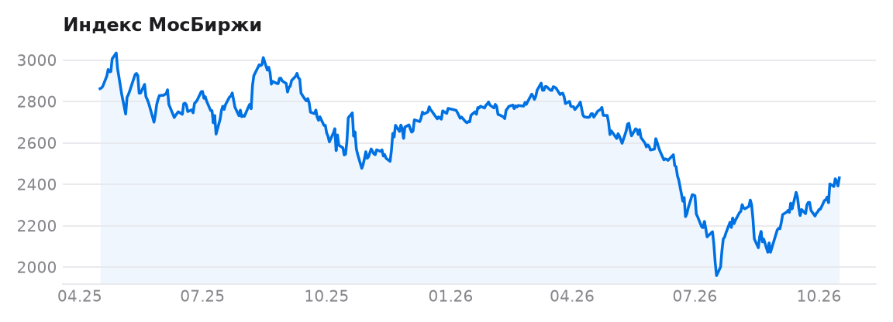
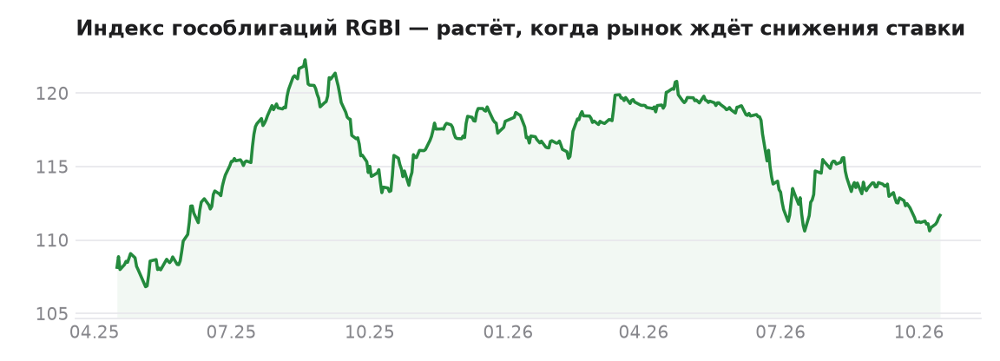
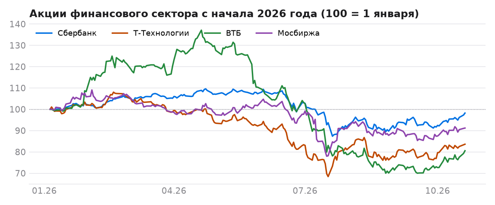
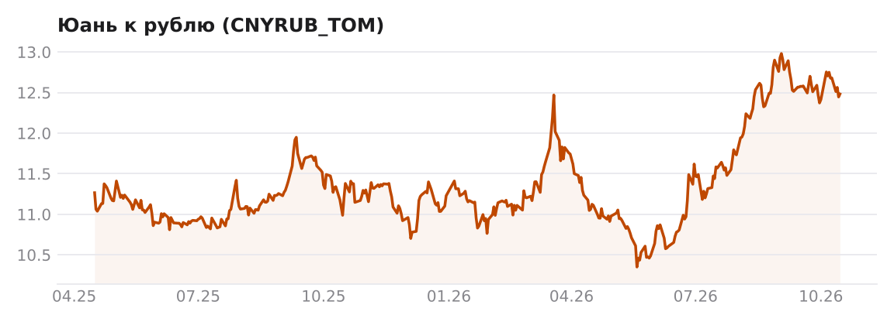

# Пульс рынка

[](https://github.com/antonshkelll/ru-market-pulse/actions/workflows/ci.yml)  

Ежедневный срез российского рынка: индекс МосБиржи, гособлигации, юань и акции финансового сектора. Данные приходят из открытого API Московской биржи, а GitHub Actions каждую ночь сам скачивает новые торги, пересчитывает показатели и обновляет этот README и [веб-страницу](https://pulse.antonshkel.ru/).

Таблицу и графики ниже собирает робот, вручную здесь ничего не правится.

<!-- PULSE:START -->
*Последние торги: 22.10.2026. Обновляется автоматически каждую ночь.*

| | Значение | За день | За месяц | С начала года |
|---|---:|---:|---:|---:|
| Индекс МосБиржи | 2 432 | −0,7% | +5,7% | −12,1% |
| Индекс гособлигаций RGBI | 111,99 | −0,1% | −0,3% | −5,2% |
| Юань | 12,16 ₽ | −0,5% | −3,5% | +8,3% |
| Сбербанк | 291,20 ₽ | −0,1% | +3,7% | −2,9% |
| Т-Технологии | 268,88 ₽ | −0,6% | +4,1% | −18,0% |
| ВТБ | 56,55 ₽ | −0,9% | +10,0% | −21,7% |
| Мосбиржа | 154,09 ₽ | −0,8% | +2,3% | −11,1% |

Цены акций скорректированы на корпоративные события: Т-Технологии — сплит 10:1 (17.04.2026); ВТБ — консолидация 1:5000 (15.07.2024).








<!-- PULSE:END -->

## Как это работает

```
MOEX ISS API ──► pulse/iss.py ──► data/*.csv ──► pulse/build.py ──► README.md, charts/*.png, docs/data.json
     ▲                (история, пагинация)       (KPI, графики)                       │
     └──────────────── GitHub Actions, каждый день в 00:15 МСК ◄──────────────────────┘
```

[`pulse/iss.py`](pulse/iss.py) забирает историю закрытий из [MOEX ISS](https://iss.moex.com/iss/reference/) постранично; повторные запуски докачивают только последние дни. История лежит в `data/*.csv` прямо в репозитории, поэтому каждое изменение видно в истории коммитов.

Показатели: изменение за день, за 30 дней и с начала года, с поправкой на сплиты. Месяц считается от последнего закрытия не позже, чем 30 дней назад, так что выходные и праздники не ломают расчёт.

Если биржа не ответила по какой-то бумаге, остаются прошлые данные и сборка не падает. Workflow завершается ошибкой, только если не удалось получить ни одного ряда.

Веб-страница [`docs/index.html`](docs/index.html) статическая, без сборщиков: Chart.js читает `docs/data.json`.

## Что отслеживается

| Ряд | Код на бирже | Зачем смотреть |
|---|---|---|
| Индекс МосБиржи | IMOEX | общее настроение рынка акций |
| Индекс гособлигаций | RGBI | растёт, когда рынок ждёт снижения ключевой ставки |
| Юань к рублю | CNYRUB_TOM | основная валютная пара биржи после остановки торгов долларом |
| Сбербанк, Т-Технологии, ВТБ, Мосбиржа | SBER, T, VTBR, MOEX | финансовый сектор: банки и сама биржа |

Чтобы добавить бумагу, достаточно одной строки в списке `SERIES` в [`pulse/iss.py`](pulse/iss.py).

## Запуск у себя

Нужен Python 3.10+ и доступ к iss.moex.com.

```bash
git clone https://github.com/antonshkelll/ru-market-pulse.git
cd ru-market-pulse
python3 -m venv .venv && source .venv/bin/activate      # Windows: py -m venv .venv; .venv\Scripts\Activate.ps1
pip install -r requirements.txt
python -m pulse.build          # скачать данные и пересобрать всё
python -m pulse.build --offline  # пересобрать из уже скачанных data/*.csv
pytest -q                      # тесты на поддельном API: пагинация, сбои сети, расчёт KPI
```

Веб-страницу можно открыть локально: `python -m http.server -d docs 8000` → http://localhost:8000.

### Свой экземпляр с автообновлением

1. Fork этого репозитория.
2. Actions → включить workflows → «Update data» → Run workflow (первый запуск скачает историю с 2024 года).
3. Settings → Pages → Deploy from a branch → `main` / `docs`, и через минуту страница будет по адресу `https://<ваш-логин>.github.io/ru-market-pulse/`. Файл `docs/CNAME` с доменом `pulse.antonshkel.ru` в своей копии удалите или впишите свой домен.

## Ограничения

- Сплиты и консолидации акций определяются автоматически (скачок цены больше чем в 3 раза за день) и учитываются в расчётах; в `data/` хранятся сырые цены биржи. Дивиденды не корректируются: в день дивидендного гэпа акция «падает» на размер выплаты.
- Дашборд только показывает данные. Это не торговая система и не инвестиционная рекомендация.

## Связанные проекты

- [Экономика быстрого платежа](https://github.com/antonshkelll/sbp-economics): исследование и [калькулятор](https://sbp.antonshkel.ru)
- [Профиль](https://github.com/antonshkelll/antonshkelll), где карточка рынка обновляется каждую ночь

Все проекты собраны в [профиле](https://github.com/antonshkelll).
